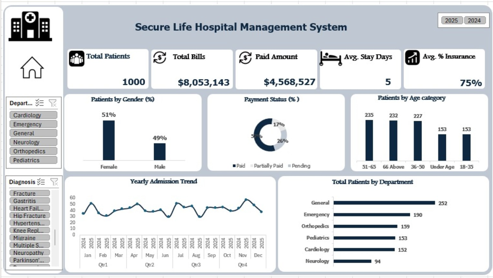

# secure-life-hospital-performance-dashboard
Interactive Microsoft Excel 2010 Performance Dashboard analyzing 1,000 patient visits, departmental admissions, billing collections, and insurance coverage for Secure Life General Hospital.

# 🏥 SECURE LIFE GENERAL HOSPITAL PERFORMANCE DASHBOARD
### *Operational & Financial Healthcare Analytics Built in Microsoft Excel 2010*

[📌 Introduction](#-i-introduction) • [📂 About the Dataset](#-ii-about-the-dataset) • [❓ Problem Statement](#-iii-problem-statement) • [📊 Visualization](#-iv-visualization) • [🔍 Insights](#-v-insights) • [🎯 Recommendations](#-vi-recommendations) • [🏁 Conclusion](#-vii-conclusion)

---

## 📌 I. Introduction
Secure Life General Hospital delivers inpatient and outpatient clinical care across six specialized departments. To improve operational visibility, monitor cash collections, and evaluate insurance coverage disparities, this project transforms 1,000 clinical visit records (2024–2025) into an interactive Microsoft Excel 2010 Performance Dashboard powered by PivotTables, PivotCharts, dynamic KPI cards, and multi-connected Slicers.

> Executive Headline: Across 1,000 recorded patient visits, Secure Life General Hospital generated \$8,053,143 in total billings with an average length of stay of 4.8 days and 75% average insurance coverage—yet \$3,484,616 (43.3%) remains uncollected across *Pending* and *Partially Paid* accounts.

---

## 📂 II. About the Dataset
The workbook ([Secure_Life_Hospital_Dashboard.xlsx](Secure_Life_Hospital_Dashboard.xlsx)) contains 1,000 patient visit records (PAT-3001 to PAT-4000) spanning January 2024 through December 2025, comprising 11 raw attributes and 5 engineered analytical columns:

* Patient & Clinical Attributes: Patient ID, Patient Name, Age, Gender, Department *(6 departments)*, and Diagnosis *(28 distinct diagnoses)*.
* Stay Duration Attributes: Admission Date, Discharge Date, and calculated **Stay Length** (=Discharge Date - Admission Date).
* Financial & Billing Attributes: Total Bill Amount, Insurance Coverage %, Payment Status *(Paid, Partially Paid, Pending)*, plus calculated **Amount Paid** (=IF(Payment Status="Paid", Total Bill Amount, 0)) and **Outstanding Balance**.
* Cohort & Time Grouping Attributes: Calculated **Age Group *(5 clinical brackets)* and Year** (2024 and 2025).

---

## ❓ III. Problem Statement
Hospital leadership observed shifts in patient admissions, rising unpaid medical bills, and uneven insurance coverage across departments. Lacking a consolidated analytical report, management needed an interactive dashboard to:
1. Track patient visit volume and seasonal admission trends across 2024 and 2025.
2. Quantify total billings, realized collections, and outstanding receivables.
3. Assess departmental demand, average length of stay, and insurance coverage gaps to support data-driven operational decisions.

---

## 📊 IV. Visualization

### Executive KPI Summary Strip

| No. of Patients (Visits) | Total Bill Amount | Avg. Stay Length | Total Amount Paid | Avg. Insurance Coverage | Outstanding Balance |
| :---: | :---: | :---: | :---: | :---: | :---: |
| 1,000 Visits | \$8,053,143 | 4.8 Days | \$4,568,527 | 75% | \$3,484,616 |

---

## 🔍 V. Insights

### Answers to Management's 10 Core Project Objectives
1. Total Recorded Patient Visits: The hospital recorded 1,000 patient visits (510 Female [51%] and 490 Male [49%]).
2. Highest-Volume Departments: General leads with 252 visits (25.2%), followed by Emergency (190), Orthopedics (159), Pediatrics (153), Cardiology (152), and Neurology (94).
3. Highest-Billing Departments: Orthopedics generates the highest total billings despite ranking third in visit count, followed by Cardiology and Neurology, driven by high-cost surgical procedures (*Knee Replacement*, *Hip Fracture*, *Spinal Disc Herniation*).

4. 4. Average Length of Stay (ALOS): Overall ALOS is 4.8 days—highest in Orthopedics and Neurology (~7–9 days for surgical recovery) and lowest in Emergency (~1–2 days for acute stabilization).
5. Payment Status Distribution: 57% (570 visits) are Paid, 26% (260 visits) are Partially Paid, and 17% (170 visits) remain Pending.
6. Total Billed vs. Outstanding Amount: Out of \$8,053,143 billed, \$4,568,527 (56.7%) has been paid in full while \$3,484,616 (43.3%) remains outstanding across *Partially Paid* and *Pending* visits.
7. Insurance Coverage Variations: Insurance coverage averages 75% overall (ranging from 0% self-pay to 100%), with uninsured (0%) high-cost surgical and cardiac admissions creating the steepest collection risks.
8. Visits by Age Group: Older cohorts represent the largest share of hospital visits:
   * Between 51 & 65: 235 visits (23.5%)
   * 66 & Above: 232 visits (23.2%)
   * Between 36 & 50: 210 visits (21.0%)
   * Between 18 & 35: 170 visits (17.0%)
   * Under 18: 153 visits (15.3%)
9. Admissions & Billing Trends Over Time: Patient volume remains consistent across 2024 and 2025, with recurring Q3–Q4 peaks fueled by respiratory conditions (*Pneumonia*, *Flu Complications*, *RSV*) and orthopedic procedures.
10. Key Areas Requiring Management Attention: Accounts Receivable collection lag (43.3% uncollected balance), General & Emergency department capacity load (44.2% of total visits), and **self-pay (0% insurance) high-bill cases**.

### Additional Analytical Insights Beyond the Brief
* Repeat Patient Visit Frequency: Because each row captures an individual visit rather than a unique patient, repeat patient names (e.g., *Elizabeth Rodriguez*, *Michelle Wilson*, *Karen Smith*, *Kenneth Lewis*) appear multiple times across chronic conditions (*Diabetes Management*, *Hypertension*, *Atrial Fibrillation*), demonstrating strong opportunity for outpatient chronic-care management.
* High-Acuity Revenue Concentration: Together, Orthopedics and Cardiology generate nearly half of total hospital billings while accounting for only 31.1% of total visits.

---

## 🎯 VI. Recommendations
* 1. Automate Receivables Recovery & Installment Plans: Launch automated billing follow-ups and structured payment plans for the 430 Pending and Partially Paid accounts (\$3.48M outstanding), prioritizing high-value surgical balances above \$15,000.
* 2. Pre-Admission Financial Screening for Low-Coverage Patients: Flag patients with 0%–50% insurance coverage in *Orthopedics* and *Cardiology* before elective admissions to arrange upfront deposits or financial counseling.
* 3. Expand General & Emergency Triage Capacity: Reallocate nursing shifts and fast-track triage resources toward General (252 visits) and Emergency (190 visits), particularly during Q3–Q4 seasonal respiratory surges.
* 4. Introduce Chronic Care Follow-Up Programs: Enroll repeat-visit patients managing *Diabetes*, *Hypertension*, and *Asthma* into preventive outpatient check-ins to reduce avoidable inpatient readmissions.

---

## 🏁 VII. Conclusion
Through this interactive Excel 2010 Performance Dashboard, Secure Life General Hospital gains immediate visibility into departmental patient demand, seasonal admission patterns, and billing collection efficiency. Addressing the \$3.48M outstanding receivables backlog while strengthening pre-admission insurance verification will substantially improve hospital cash flow and patient care operations.
